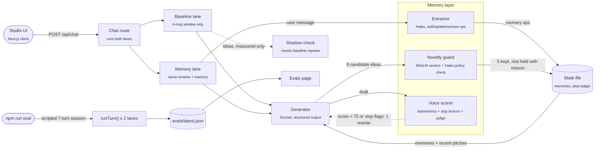
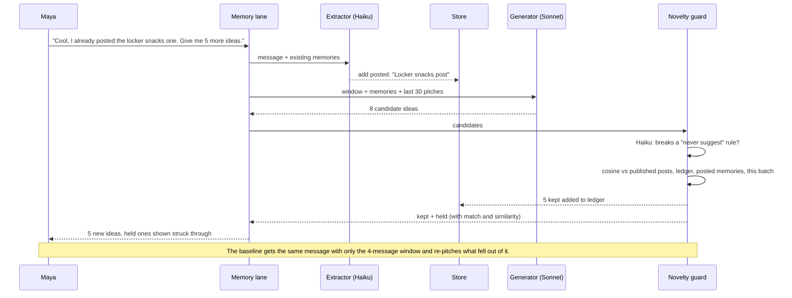

<a id="readme-top"></a>

<!-- PROJECT SHIELDS -->
<div align="center">

[![Contributors][contributors-shield]][contributors-url]
[![Forks][forks-shield]][forks-url]
[![Stargazers][stars-shield]][stars-url]
[![Issues][issues-shield]][issues-url]
[![MIT License][license-shield]][license-url]

</div>

<!-- PROJECT LOGO -->
<br />
<div align="center">
  <h3 align="center">Stanley Memory</h3>
  <p align="center">
    A memory layer, novelty guard and voice eval harness for Stanley, Stan's AI Head of Content
    <br />
    <a href="https://github.com/teddycitrus/stanza"><strong>Explore the docs &raquo;</strong></a>
    <br />
    <br />
    <a href="https://github.com/teddycitrus/stanza/issues/new?labels=bug">Report Bug</a>
    &middot;
    <a href="https://github.com/teddycitrus/stanza/issues/new?labels=enhancement">Request Feature</a>
  </p>
</div>

<!-- TABLE OF CONTENTS -->
<details>
  <summary>Table of Contents</summary>
  <ol>
    <li>
      <a href="#about-the-project">About The Project</a>
      <ul>
        <li><a href="#built-with">Built With</a></li>
      </ul>
    </li>
    <li><a href="#architecture">Architecture</a></li>
    <li>
      <a href="#getting-started">Getting Started</a>
      <ul>
        <li><a href="#prerequisites">Prerequisites</a></li>
        <li><a href="#installation">Installation</a></li>
      </ul>
    </li>
    <li><a href="#usage">Usage</a></li>
    <li><a href="#roadmap">Roadmap</a></li>
    <li><a href="#contributing">Contributing</a></li>
    <li><a href="#license">License</a></li>
    <li><a href="#contact">Contact</a></li>
  </ol>
</details>

<!-- ABOUT THE PROJECT -->
## About The Project

Stanley Memory is a working prototype of a memory layer for Stanley, Stan's AI Head of Content. It targets the three complaints that come up most in public Stanley reviews (App Store, review sites, 2026):

1. **It forgets.** "Can't remember things that have been said, even in the same thread." "Repetitive suggestions even after you tell it not to suggest certain things."
2. **It repeats itself and loses track of what was posted.** "Continually asks if you posted concepts you already told it you posted."
3. **Quality drifts between releases.** "The new version... every single post follows the same format. It just screams AI WROTE THIS."

The Studio runs the same creator message through two lanes side by side. Both use the same model, the same system prompt and the same 4-message rolling window. The only difference is that the right lane has the memory layer. The eval suite replays a scripted session through both lanes and gates on the result, so a prompt or model change that brings back repeats, broken rules or AI-sounding drafts fails the run.

Key capabilities:
* **Long-term memory**: a Haiku extractor turns each creator message into add, update or remove operations across five kinds (`fact`, `goal`, `preference`, `avoid`, `posted`). Every memory keeps the verbatim quote and the message it came from, and the creator can delete any of them
* **Novelty guard**: idea candidates are checked against "never suggest" rules by an LLM classifier and against published posts, earlier pitches and `posted` memories with local MiniLM embeddings. Repeats and rule breaks are held back with the reason shown
* **Voice scoring**: drafts are scored on stylometric distance from the creator's real posts, a blind LLM judge and a slop lexicon, then rewritten once if they read as AI
* **Regression gates**: `npm run eval` replays a 7-turn script through both lanes and exits non-zero if the memory lane breaks any gate

The creator (Maya Okafor, @nightshiftstrong) and her posts are fictional sample data.

<p align="right">(<a href="#readme-top">back to top</a>)</p>

### Built With

* [![Next.js][Next.js-badge]][Next-url]
* [![React][React-badge]][React-url]
* [![TypeScript][TypeScript-badge]][TypeScript-url]
* [![Anthropic][Anthropic-badge]][Anthropic-url]
* [![Transformers.js][Transformers-badge]][Transformers-url]

<p align="right">(<a href="#readme-top">back to top</a>)</p>

<!-- ARCHITECTURE -->
## Architecture





Every memory-lane turn runs in this order:

1. The extractor turns the creator's message into memory operations (`fact`, `goal`, `preference`, `avoid`, `posted`). Each memory keeps the verbatim quote and the message it came from. The creator can delete any memory from the panel.
2. The generator gets the same rolling window as the baseline (4 messages), plus the rendered memories and the last 30 ideas it pitched.
3. For idea requests it asks for 8 candidates. The guard drops any that break an `avoid` rule (Haiku classifier) or sit within 0.66 cosine of a published post, an earlier pitch, a `posted` memory or another idea in the same batch. It keeps up to 5. If fewer than 3 survive, it regenerates once with the rejects as negative examples.
4. Drafts are scored. Score = 50% stylometric distance from her 12 synced posts + 50% blind Haiku judge, minus 6 per slop flag. Below 75 or with any flag, the draft is rewritten once with the specific issues, and the better of the two is kept.

Limits and guarantees:

- Same model, prompt and window in both lanes; the comparison isolates the memory layer.
- Every model call uses structured outputs, so responses are schema-valid JSON. Adaptive thinking counts against `max_tokens`, so each call gets 4000 tokens of headroom on top of its output budget.
- Embeddings run locally (all-MiniLM-L6-v2, 384 dims, q8). If the ONNX runtime fails to load, a hashed bag-of-words vector takes over, so the guard degrades instead of failing.
- Embeddings handle duplicates; policy goes to an LLM. Measured on this data: "sunrise yoga flow" scores only 0.35 against "no morning routine content", so vectors alone would let rule breaks through.
- Synced data (last post date, post count) is computed from the data and given to the model as the source of truth, so it cannot say "you haven't posted in a week" when she has.
- Requests that touch the state file go through a single in-process queue. This is a demo store; production would swap it for Postgres with pgvector behind the same `AppState` shape.
- Eval gates for the memory lane: repeat rate <= 10%, rule violations <= 5%, recall = 100%, voice >= 70. `npm run eval` exits 1 when any gate fails.

<p align="right">(<a href="#readme-top">back to top</a>)</p>

<!-- GETTING STARTED -->
## Getting Started

### Prerequisites

* Node.js 22+
* An Anthropic API key

### Installation

1. Clone the repo
   ```sh
   git clone https://github.com/teddycitrus/stanza.git
   cd stanza
   ```

2. Install dependencies
   ```sh
   npm install
   ```

3. Copy the example environment file and add your key
   ```sh
   cp .env.example .env.local
   ```

   ```env
   ANTHROPIC_API_KEY=
   # Optional overrides
   STANLEY_CHAT_MODEL=claude-sonnet-5-5
   STANLEY_FAST_MODEL=claude-haiku-5-5
   ```

4. Start the development server
   ```sh
   npm run dev
   ```

   Open [http://localhost:3000](http://localhost:3000). The first request downloads the MiniLM model (about 23 MB) into the transformers.js cache.

<p align="right">(<a href="#readme-top">back to top</a>)</p>

<!-- USAGE -->
## Usage

**Studio**

The home page shows the Baseline and With memory lanes side by side. Type a message, or step through the scripted session (set context and rules, ask for ideas, mark one posted, two more batches, a recall check, a caption draft). Memories appear in the right panel with the quote they came from; held ideas show what they matched and how closely.

**Eval suite**

`npm run eval` replays the 7-turn script through both lanes, writes `evals/latest.json` and exits non-zero on a failed gate. `npm run eval -- --runs 3` averages several runs. The report is viewable at `/evals`.

**Commands**

| Command | What it does |
| --- | --- |
| `npm run dev` | Studio at `/`, eval report at `/evals` |
| `npm run eval` | Scripted regression run against both lanes, gated on the memory lane |
| `npm run test:unit` | Offline checks (no key): slop detector, stylometrics, guard thresholds on real embeddings |
| `npm run typecheck` | `tsc --noEmit` |
| `npm run build` | Production build |

State lives in `.data/state.json` (gitignored). `POST /api/reset` clears it.

**Code map**

| File | Role |
| --- | --- |
| `src/lib/agent.ts` | One turn for either lane: memory, generation, guard, voice loop |
| `src/lib/memory.ts` | Extraction prompt, op application with provenance, rendering |
| `src/lib/novelty.ts` | Guard, policy classifier, baseline shadow check, thresholds |
| `src/lib/voice.ts` | Slop lexicon, stylometric features, blind judge, blended score |
| `src/lib/embed.ts` | Local embeddings with lexical fallback |
| `src/lib/llm.ts` | Anthropic client and the structured-output helper every model call uses |
| `src/lib/script.ts` | The scripted session shared by the Studio and the eval suite |
| `scripts/eval.ts` | Regression suite and gates |

<p align="right">(<a href="#readme-top">back to top</a>)</p>

<!-- ROADMAP -->
## Roadmap

- [x] Side-by-side Studio comparing a stateless baseline with the memory lane
- [x] Memory extraction with provenance and user-deletable memories
- [x] Novelty guard combining local embeddings with an LLM policy check
- [x] Voice scoring with a single targeted rewrite
- [x] Scripted eval suite with pass/fail gates
- [ ] Run `npm run eval` in CI so prompt or model changes are gated before merge
- [ ] Swap the JSON state file for Postgres with pgvector behind the same `AppState` shape

See the [open issues](https://github.com/teddycitrus/stanza/issues) for a full list of proposed features and known bugs.

<p align="right">(<a href="#readme-top">back to top</a>)</p>

<!-- CONTRIBUTING -->
## Contributing

Contributions are welcome. If you have a suggestion, please fork the repo and open a pull request, or file an issue with the `enhancement` label.

1. Fork the project
2. Create your feature branch (`git checkout -b feature/my-feature`)
3. Commit your changes (`git commit -m 'Add my feature'`)
4. Push to the branch (`git push origin feature/my-feature`)
5. Open a pull request

<p align="right">(<a href="#readme-top">back to top</a>)</p>

<!-- LICENSE -->
## License

Distributed under the MIT License. See `LICENSE` for more information.

<p align="right">(<a href="#readme-top">back to top</a>)</p>

<!-- CONTACT -->
## Contact

Project Link: [https://github.com/teddycitrus/stanza](https://github.com/teddycitrus/stanza)

<p align="right">(<a href="#readme-top">back to top</a>)</p>

<!-- MARKDOWN LINKS & BADGES -->
[contributors-shield]: https://img.shields.io/github/contributors/teddycitrus/stanza.svg?style=for-the-badge&cacheSeconds=60
[contributors-url]: https://github.com/teddycitrus/stanza/graphs/contributors
[forks-shield]: https://img.shields.io/github/forks/teddycitrus/stanza.svg?style=for-the-badge&cacheSeconds=60
[forks-url]: https://github.com/teddycitrus/stanza/network/members
[stars-shield]: https://img.shields.io/github/stars/teddycitrus/stanza.svg?style=for-the-badge&cacheSeconds=60
[stars-url]: https://github.com/teddycitrus/stanza/stargazers
[issues-shield]: https://img.shields.io/github/issues/teddycitrus/stanza.svg?style=for-the-badge&cacheSeconds=60
[issues-url]: https://github.com/teddycitrus/stanza/issues
[license-shield]: https://img.shields.io/badge/license-MIT-blue.svg?style=for-the-badge
[license-url]: https://github.com/teddycitrus/stanza/blob/main/LICENSE

[Next.js-badge]: https://img.shields.io/badge/Next.js-000000?style=for-the-badge&logo=nextdotjs&logoColor=white
[Next-url]: https://nextjs.org/
[React-badge]: https://img.shields.io/badge/React-20232A?style=for-the-badge&logo=react&logoColor=61DAFB
[React-url]: https://react.dev/
[TypeScript-badge]: https://img.shields.io/badge/TypeScript-3178C6?style=for-the-badge&logo=typescript&logoColor=white
[TypeScript-url]: https://www.typescriptlang.org/
[Anthropic-badge]: https://img.shields.io/badge/Anthropic-191919?style=for-the-badge&logo=anthropic&logoColor=white
[Anthropic-url]: https://www.anthropic.com/
[Transformers-badge]: https://img.shields.io/badge/Transformers.js-FFD21E?style=for-the-badge&logo=huggingface&logoColor=black
[Transformers-url]: https://huggingface.co/docs/transformers.js
